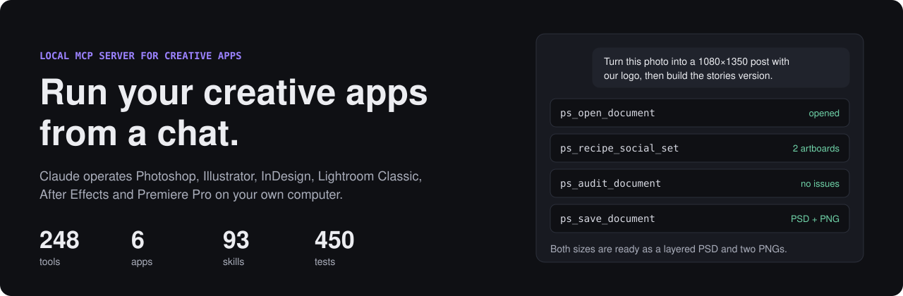
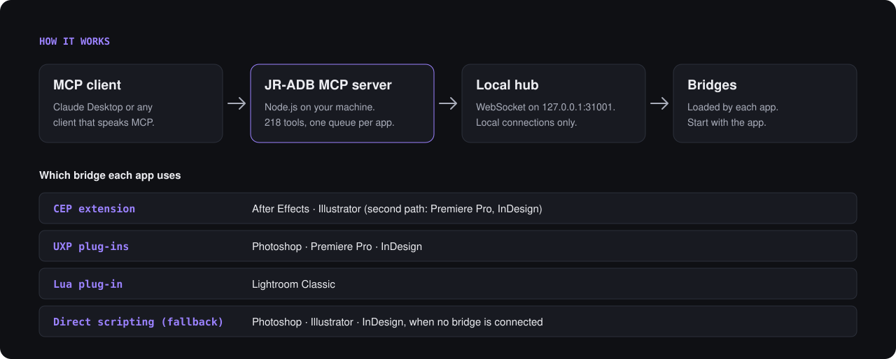
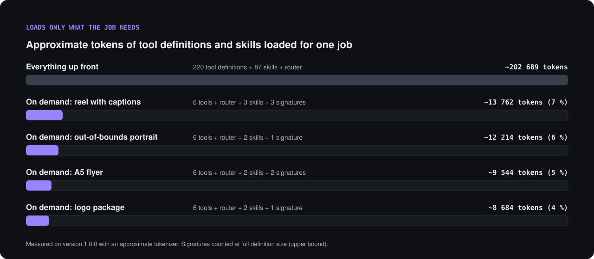
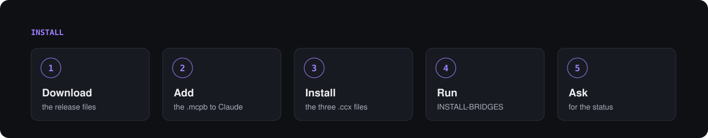

<p align="center">
  <a href="#download"></a>
</p>

# JuniorRocha MCP for Adobe Creative Cloud

A local [Model Context Protocol](https://modelcontextprotocol.io) server that lets Claude, and other MCP
clients, operate **Photoshop, Illustrator, InDesign, Lightroom Classic, After Effects and Premiere Pro** on
your own computer. You describe the job, the apps do the work, and you keep editable files.

## Download

**[Download the latest release](https://github.com/DicoRocha/JuniorRocha-MCP-for-Adobe-Creative-Cloud-Apps/releases/latest)**
and pick the zip for your assistant. Each one has every installer and an `INSTALL.txt` in the right order:

| Zip | For | Server install |
|---|---|---|
| `JuniorRocha-MCP-<version>-claude.zip` | Claude Desktop | Settings → Extensions → install the `.mcpb` |
| `JuniorRocha-MCP-<version>-chatgpt.zip` | ChatGPT desktop app | Double-click `INSTALL-CHATGPT.bat` (macOS: `INSTALL-CHATGPT.command`); needs [Node.js](https://nodejs.org) 20+ |

Inside both:

| Folder | What it is | How to install |
|---|---|---|
| `1-server` | The server | As in the table above |
| `2-plugins` | Plug-ins for Photoshop, Premiere Pro and InDesign (`.ccx`) | Double-click each one you need; Creative Cloud installs it |
| `3-bridges-kit` | Bridges for After Effects, Illustrator and Lightroom Classic | Close those apps, then double-click `INSTALL-BRIDGES.bat` (Windows) or `INSTALL-BRIDGES.command` (macOS) |

Install only the parts for the apps you use. Then open your apps and ask: *"Check the status of my creative
apps."* Step by step, with requirements and troubleshooting: [Install](#install). Prefer to build it yourself?
See [Install from source](#install-from-source).

**Updating only one part?** The same release also has each installer as a separate file
(`jr-adb-mcp-bridge-<version>.mcpb`, the three `.ccx` files and `jr-adb-mcp-bridge-bridges-kit-<version>.zip`).

> **Status: preview.** Windows is the main tested platform. macOS was validated once, on Apple Silicon
> ([`docs/MACOS.md`](docs/MACOS.md)).
>
> **Independent project.** Not affiliated with, sponsored by or endorsed by Adobe. Adobe, Creative Cloud,
> Photoshop, Illustrator, InDesign, Lightroom, After Effects and Premiere Pro are trademarks of Adobe Inc.

## Contents

- [What makes it different](#what-makes-it-different)
- [Some examples of what you can ask](#some-examples-of-what-you-can-ask)
- [A full campaign, with you in charge](#a-full-campaign-with-you-in-charge)
- [How it works](#how-it-works)
- [Two tool modes](#two-tool-modes)
- [On-demand loading](#on-demand-loading)
- [Download](#download)
- [Install](#install)
- [Client setup](#client-setup)
- [Updating and uninstalling](#updating-and-uninstalling)
- [Configuration](#configuration)
- [Tools](#tools)
- [Skills](#skills)
- [Working safely](#working-safely)
- [Troubleshooting](#troubleshooting)
- [Limitations and security](#limitations-and-security)
- [Privacy](#privacy)
- [Compatibility](#compatibility)
- [Documentation](#documentation)
- [Development](#development)
- [FAQ](#faq)

## What makes it different

- **Six apps behind one server.** One install, one status call, one queue per app.
- **Nothing to load by hand.** The bridges are installed once and start with each app. You do not open a
  developer tool or press Connect on every launch.
- **Recipes, not only primitives.** Besides layer-level and clip-level tools there are one-call recipes that
  deliver a finished, editable piece: a social set, a flyer, a logo package, a reel, captions.
- **Audits.** Tools that review a document, a timeline or an animation and report what would fail at delivery.
- **Built to protect client work.** One undo step per command with rollback on failure, a project lock for
  Premiere, and a switch per app.
- **Loads only what the job needs.** By default the client sees seven tools and looks up the other commands by
  name when a job calls for them; skills are loaded one by one through a router. See
  [On-demand loading](#on-demand-loading).
- **Workflow knowledge included.** 91 skills describe how studio work is done in these apps, from the brief
  to the delivery check.
- **Skills first.** The assistant looks up the skills a request needs, tells you which ones it will follow and
  asks once before it starts. Tools that create or change work stay locked until it has. See
  [Skills first](#skills-first).
- **Tested.** 387 automated tests run on every setup, including a simulated app and the Lightroom plug-in.

## Some examples of what you can ask

**Photoshop**

```text
• Open this photo and build a 1080×1350 post and a 1080×1920 story with my logo in the corner.
• Select the subject, put it on a new background layer in brand purple, and keep everything editable.
• Audit this PSD before I send it: fonts, hidden layers, colour profile, sizes.
• Make the out-of-bounds effect on the photo layer of this layout: the person coming out of a circle.
• Add a stroke, a drop shadow and a bevel to this group, and keep the styles it already has.
```

**Illustrator**

```text
• Export a logo package from this file: SVG, PDF and PNG, in colour, black and white.
• Draw a badge with a circle, a ribbon and the text on a path, using my swatches.
• Place this portrait and make it come out of a circle with an outline, using clipping masks.
```

**InDesign**

```text
• Make an A5 flyer from this text and these two images, with paragraph styles I can change later.
• Run a preflight on the open document and tell me what is overset or missing.
```

**Lightroom Classic**

```text
• Apply this develop preset to the selected photos, create a snapshot first, and export JPEGs at 2048 px.
• Add an S-curve and warm the white balance on the picked photos of this collection.
```

**After Effects**

```text
• Bring this logo in as shape layers and reveal it with Trim Paths and eased keyframes.
• Add a torn-paper transition between these two layers at 3 seconds.
• Audit this comp before I render: linear keyframes, expression errors, missing footage.
```

**Premiere Pro**

```text
• Assemble a 30-second vertical reel from the clips in this folder, cut on the music beats.
• Put captions on the active sequence from this SRT as editable graphics, two lines maximum.
• Transcribe this interview in Portuguese with Premiere's own speech-to-text and give me the lines.
• Find the cuts in this finished video and split it back into shots.
```

**Across apps**

```text
• Take the active Illustrator artwork into After Effects as shape layers.
• Build the brand template set from the brand kit folder.
• Check the status of my creative apps.
```

## A full campaign, with you in charge

The larger use is a whole campaign: print, digital, motion and video from one brief. The creative decisions
stay with you. You write the brief, choose the concept, approve the key visual and approve the video. The
server does the production around those decisions: the resizing, the versions, the exports, the checks.

**What you prepare**

A campaign folder with a `00_briefing` folder inside: the brief, the brand kit (logo, colours, fonts) and a
piece plan, `plano-de-pecas.json`, listing what has to be delivered. You can write the plan with the
assistant in conversation; the planning skills cover briefing, concept, social calendar, video script and
print layout.

**What happens**

| Stage | What the server does | Tools behind it | You |
|---|---|---|---|
| Photos | Develops the selected photos as a batch | `lr_recipe_batch_develop` | Pick the photos and the look |
| Vectors | Exports the logo package and builds the brand templates | `ai_recipe_logo_package`, `jradb_templates_build` | Supply the logo and the kit |
| Key visual | Cuts out backgrounds and prepares product shots for your layout | `ps_recipe_remove_background`, `ps_recipe_product_shot`, `ps_recipe_pop_out`, `ai_recipe_pop_out` | **Design it and approve it** |
| Formats | Derives the approved piece into every size and variant | `ps_recipe_social_set`, `ps_batch_variants`, `ai_batch_variants` | Review the set |
| Motion | Builds lower thirds, title cards, counters, logo reveals and transitions | `ae_create_lower_third`, `ae_create_title_card`, `ae_create_logo_reveal` | Adjust timing and easing |
| Video | Assembles the reel from your clips. Captions can be added afterwards as editable graphics. | `pr_assemble_reel` | **Approve the cut** |
| Print | Lays out the flyer, catalogue or manual and runs data merge | `id_recipe_flyer`, `id_recipe_catalog`, `id_data_merge` | Check the proof |
| Package | Makes a contact sheet of everything and the printer package | `jradb_contact_sheet`, `id_package` | Sign off |

Run it with one request:

```text
Run the campaign in D:\Clients\Acme\2026_Launch. Stop at each approval point.
```

- **It stops for you.** The run pauses at the approval points in the plan (concept, key visual, video) and
  continues only when you approve.
- **It picks up where it left off.** Progress is saved in the campaign folder, so a run can continue the next
  day.
- **Everything stays editable.** You get layered PSDs, live text and styles in InDesign, shape layers and
  keyframes in After Effects, and a normal Premiere sequence. Open any piece and change it by hand.
- **Hand-made pieces count.** If you prefer to make a piece yourself, it is marked as done in the plan and
  the run carries on from there.
- **It ends with a report.** A delivery report in `06_entrega` lists what was produced and what failed.

It does not replace the idea, the layout or the eye. It takes the mechanical part of production off your
desk, and it is faster to correct a piece than to rebuild it in twelve sizes.

## How it works

<p align="center">
  
</p>

1. The MCP client starts the server (`node dist/index.js`) and talks to it over stdio.
2. The server opens a hub on `127.0.0.1:31001`.
3. Each app loads a small bridge that connects to the hub when the app starts.
4. A tool call becomes a command for one app. It waits its turn in that app's queue, runs as one undo step,
   and returns structured data, plus a preview image when the tool produces one.

| Bridge | Apps | Notes |
|---|---|---|
| UXP plug-ins | Photoshop, Premiere Pro, InDesign | Photoshop and InDesign also run ExtendScript through the same plug-in, so one plug-in covers every command |
| CEP extension (invisible, starts with the app) | After Effects, Illustrator, and a second path for Premiere Pro and InDesign | ExtendScript |
| Lua plug-in | Lightroom Classic | Loaded from the Modules folder |
| Direct scripting | Photoshop, Illustrator, InDesign | Fallback when no bridge is connected (COM on Windows) |

## Two tool modes

| Mode | What the client sees | When to use |
|---|---|---|
| `code` (default) | 7 tools: `jradb_get_status`, `jradb_code`, `jradb_api`, `jradb_find_skills`, `jradb_get_skill`, `jradb_launch_app`, `jradb_usage` | Everyday use. `jradb_code` runs a short script that can call any of the 227 tools and return only what matters. |
| `full` | All 227 tools | Clients without good scripting, or when you want each call visible and approved one by one. |

Switch with `--tools full` or `JRADB_MCP_TOOLS=full`. In the Claude Desktop extension it is the *tool mode*
setting.

## On-demand loading

A server with 227 tools and 91 skills would normally fill the conversation before any work starts. This one
loads only what the job in front of it needs, for commands and for skills alike.

<p align="center">
  
</p>

**Commands.** In the default mode the client sees seven tools (about 1,400 tokens instead of about 69,000 for
all 221 definitions). When the assistant needs a command it asks `jradb_api` for it, by name, by app prefix or
by words (`search: "captions"`), and gets back only those signatures. Then `jradb_code` runs a short script
that calls them and returns only what matters, so long intermediate results never enter the conversation.

**Skills.** `jradb_find_skills { task }` ranks the skills for a request written in plain words.
`jradb_get_skill` with no arguments returns a router of about 3,500 tokens. It reads the request
and names the skills to load and in what order. Each skill is then loaded by name (about 1,200 tokens at the
median), and a skill's reference files only when a step calls for them. The other skills stay on disk.

| Request | Skills loaded | Signatures looked up | Context, approx. |
|---|---|---|---:|
| Out-of-bounds portrait | cut-out and compositing, Photoshop rules | `ps_recipe_pop_out` | 12,200 |
| 30-second reel with captions | reels, captions and sound, Premiere rules | `pr_assemble_reel`, `pr_captions_as_mogrt`, `pr_audit_timeline` | 13,800 |
| A5 flyer | flyers and posters, InDesign rules | `id_recipe_flyer`, `id_preflight` | 9,500 |
| Logo package | brand package, Illustrator rules | `ai_recipe_logo_package` | 8,700 |
| Everything loaded up front | all 87 | all 221 | 202,700 |

Figures are estimates from an approximate tokenizer, measured on version 1.8.0; each total includes the six
tools and the router, and counts a signature at its full definition size.

## Skills first

No task in the apps starts without the skills it needs. The server sends this rule to every client when it
connects, so it holds in Claude, ChatGPT, Codex or Cursor alike:

1. Before the first tool that creates or changes work, the assistant looks up the skills itself:
   `jradb_find_skills` with the request in plain words, or the router from `jradb_get_skill`.
2. It tells you which skills it will follow, one line each, and asks once whether to go ahead with them.
   With no answer it goes ahead with them and says so in its report.
3. It loads each skill and follows its steps and its delivery check (`qa-revisao-visual`).
4. If no skill covers the request, it says so before starting.

Tools that create or change work answer `SKILLS_REQUIRED` until skills were looked up in the session. Tools
that only read or preview (status, lists, snapshots, audits) are never locked.

| `JRADB_MCP_SKILLS_GATE` | Behaviour |
|---|---|
| `strict` (default) | Creating or changing tools are blocked until skills were looked up |
| `notice` | The tool runs and its answer carries a reminder |
| `off` | No check |

## Install

<p align="center">
  <a href="#install"></a>
</p>

**You need**

- Windows 10 or 11, or macOS (see [`docs/MACOS.md`](docs/MACOS.md))
- [Claude Desktop](https://claude.ai/download), the ChatGPT desktop app, or another MCP client
- The apps you want to drive, signed in and opened at least once
- Port `31001` free on your computer (the panels connect to it)

**Steps**

1. **Download and extract** `JuniorRocha-MCP-<version>-claude.zip` or `JuniorRocha-MCP-<version>-chatgpt.zip`
   from the [latest release](https://github.com/DicoRocha/JuniorRocha-MCP-for-Adobe-Creative-Cloud-Apps/releases/latest).

2. **Install the server.**
   - **Claude Desktop:** Settings → Extensions → install the `.mcpb` from `1-server`. Quit Claude (on Windows,
     from the system tray) and open it again.
   - **ChatGPT desktop app:** close ChatGPT and double-click `INSTALL-CHATGPT.bat` in `1-server` (macOS:
     `chmod +x INSTALL-CHATGPT.command`, then double-click it). It copies the server to
     `%LOCALAPPDATA%\JuniorRocha-MCP\server` (macOS: `~/Library/Application Support/JuniorRocha-MCP/server`)
     and adds `junior-rocha-mcp` to the app's MCP settings (`~/.codex/config.toml`, backed up first). Open
     ChatGPT again; the server is listed in Settings → MCP servers. Needs [Node.js](https://nodejs.org) 20 or
     newer.

3. **Install the plug-ins for Photoshop, Premiere Pro and InDesign.** Double-click each `.ccx` in `2-plugins`.
   Creative Cloud asks for confirmation and installs it. Open the Junior Rocha MCP panel once in each app so it
   activates.

4. **Install the bridges for After Effects, Illustrator and Lightroom Classic.** Close those apps and, in
   `3-bridges-kit`, double-click `INSTALL-BRIDGES.bat` (macOS: `chmod +x INSTALL-BRIDGES.command`, then
   double-click it). It copies the panel and the Lightroom
   plug-in to your user folders and switches on the CEP debug mode.

5. **Check the connection.** Open your apps and ask Claude for the status. Each app should be listed with a
   bridge (`uxp`, `cep` or `lua`).

**Good to know**

- Inside the apps the panels are named **Junior Rocha MCP** (Window → Extensions, or Plugins). After installing
  or updating a `.ccx`, open its panel once so it activates; after that you do not need to open them. They
  hold the on/off switch for that app and a Reconnect button.
- Lightroom Classic loads its plug-in on the next start.
- The panel for After Effects and Illustrator is not signed, which is why step 4 switches on the CEP debug
  mode. A signed `.zxp` is produced only when Adobe's `ZXPSignCmd` is available at packaging time; an unsigned
  `.zxp` is refused by extension installers, so none is published.
- Without any bridge, Photoshop, Illustrator, InDesign and After Effects still answer through direct scripting,
  more slowly.

### Install from source

Use this to change the code, or to build the packages yourself. You also need [Node.js](https://nodejs.org) 20
or newer (`node -v`).

```bat
git clone https://github.com/DicoRocha/JuniorRocha-MCP-for-Adobe-Creative-Cloud-Apps.git
cd JuniorRocha-MCP-for-Adobe-Creative-Cloud-Apps
SETUP.bat
```

On macOS run `./SETUP.command` instead. Close the creative apps first. The script runs, in order:

| Stage | Log |
|---|---|
| `npm install` | `logs/00-install.log` |
| Build | `logs/0-build.log` |
| Tests | `logs/1-test.log` |
| Install the bridges into the apps (all six) | `logs/2-install-bridges.log` |
| Package the plug-ins and the bridges kit | `logs/3-package-plugins.log` |
| Diagnostics | `logs/4-doctor.log` |
| Package the Claude Desktop extension | `logs/5-package-mcpb.log` |
| Build the two download zips (Claude and ChatGPT) | `logs/6-package-complete.log` |

Each log ends in `exit=0` when the stage worked. Then install the three `.ccx` files and the `.mcpb` from
`release/`, as in steps 2 and 3 above. Step 4 is not needed: the setup already installed those bridges.

## Client setup

Claude Desktop is the main tested client, and the ChatGPT desktop app was tested by the author. The other
entries are the standard stdio configuration for each client; replace the path with your clone.

<details>
<summary><b>Claude Desktop</b> (tested)</summary>

Recommended: install the `.mcpb` (step 2 of [Install](#install)).

Alternative: run `ADD-TO-CLAUDE-DESKTOP.bat`, which adds this block to `claude_desktop_config.json` and keeps
a backup. Use one way or the other, not both.

```json
{
  "mcpServers": {
    "jr-adb-mcp-bridge": {
      "command": "node",
      "args": ["C:/path/to/clone/dist/index.js", "--apps", "all"]
    }
  }
}
```
</details>

<details>
<summary><b>ChatGPT desktop app</b> (tested)</summary>

Recommended: the `-chatgpt.zip` download and its `INSTALL-CHATGPT` (step 2 of [Install](#install)).

From a clone: Settings → MCP servers → Add server → STDIO, command `node C:/path/to/clone/dist/index.js`,
or add this to `~/.codex/config.toml` (shared by the ChatGPT desktop app and Codex). Keep the longer tool
timeout: renders and exports can take more than the 60 s default.

```toml
[mcp_servers.junior-rocha-mcp]
command = "node"
args = ["C:/path/to/clone/dist/index.js"]
startup_timeout_sec = 30
tool_timeout_sec = 900
```
</details>

<details>
<summary><b>Claude Code</b></summary>

```bash
claude mcp add jr-adb-mcp-bridge -- node C:/path/to/clone/dist/index.js --apps all
```
</details>

<details>
<summary><b>Cursor</b></summary>

`.cursor/mcp.json`

```json
{
  "mcpServers": {
    "jr-adb-mcp-bridge": {
      "command": "node",
      "args": ["C:/path/to/clone/dist/index.js", "--apps", "all"]
    }
  }
}
```
</details>

<details>
<summary><b>VS Code</b></summary>

`.vscode/mcp.json`

```json
{
  "servers": {
    "jr-adb-mcp-bridge": {
      "type": "stdio",
      "command": "node",
      "args": ["C:/path/to/clone/dist/index.js", "--apps", "all"]
    }
  }
}
```
</details>

<details>
<summary><b>Codex, Antigravity and others</b></summary>

`npm run install-ai-clients` writes the configuration for Claude Desktop, Claude Code, Codex and Antigravity.
For any other client, start `node dist/index.js --apps all` as a stdio server.
</details>

## Updating and uninstalling

**Update**

- **From the release:** download the new files and install them over the old ones, in the same order as the
  first time. A file whose version did not change does not need reinstalling.
- **From source:** `git pull`, close the creative apps, run `SETUP.bat` (or `./SETUP.command`), then reinstall
  from `release/` any `.ccx` or `.mcpb` whose version changed.

**Uninstall**

| What | Where |
|---|---|
| Claude Desktop extension | Settings → Extensions → remove |
| UXP plug-ins | Creative Cloud → Plugins → Manage plugins → uninstall the three |
| CEP extension | Delete `%APPDATA%\Adobe\CEP\extensions\com.jradbmcp.universal` |
| Lightroom plug-in | Delete `%APPDATA%\Adobe\Lightroom\Modules\JrAdbMcpBridge.lrplugin` |
| Per-app switch state | Delete `%USERPROFILE%\.jr-adb-mcp-bridge` |
| Transcription models, if downloaded | Delete `%LOCALAPPDATA%\jr-adb-mcp-bridge` |

## Configuration

Command-line options of `dist/index.js`:

| Option | Default | Meaning |
|---|---|---|
| `--apps` | `all` | Comma-separated apps to enable: `photoshop`, `illustrator`, `indesign`, `lightroom`, `after-effects`, `premiere` |
| `--port` | `31001` | Port of the local hub. The bridges expect 31001. |
| `--tools` | `code` | `code` or `full` (see [Two tool modes](#two-tool-modes)) |

Environment variables:

| Variable | Meaning |
|---|---|
| `JRADB_MCP_APPS`, `JRADB_MCP_PORT`, `JRADB_MCP_TOOLS` | Same as the options above |
| `JRADB_MCP_LOG_LEVEL` | `debug`, `info`, `warn` or `error` (default `info`) |
| `JRADB_MCP_TIMEOUT_READ_MS`, `_MEDIUM_MS`, `_HEAVY_MS`, `_PROBE_MS` | Command timeouts (defaults 30 s, 60 s, 70 s, 5 s) |
| `JRADB_MCP_FFMPEG` | Path to `ffmpeg` for the media tools, if it is not on `PATH` |
| `JRADB_MCP_MODELS` | Folder for the speech-to-text models |
| `JRADB_MCP_SKILLS_DIR` | Use another skills folder |
| `JRADB_MCP_USAGE` | `0` turns off the local usage log |
| `JRADB_MCP_USAGE_DIR` | Folder of the local usage log (default `logs/usage`) |

## Tools

| App | Tools | Examples |
|---|---:|---|
| Photoshop | 38 | `ps_recipe_social_set`, `ps_selection_and_masks`, `ps_smart_object`, `ps_audit_document` |
| After Effects | 44 | `ae_paper_transition`, `ae_morph_shapes`, `ae_import_vector_as_shapes`, `ae_audit_motion` |
| Premiere Pro | 35 | `pr_assemble_reel`, `pr_captions_as_mogrt`, `pr_native_transcript`, `pr_scene_edit_detection` |
| Illustrator | 30 | `ai_recipe_logo_package`, `ai_pathfinder`, `ai_export_assets` |
| InDesign | 32 | `id_recipe_flyer`, `id_manage_styles`, `id_preflight`, `id_export` |
| Lightroom Classic | 23 | `lr_recipe_batch_develop`, `lr_tone_curve`, `lr_export_photos` |
| Shared, media and text | 18 | `jradb_get_status`, `jradb_code`, `jradb_templates_build`, `jradb_campaign_run` |

Every tool with its parameters, one page per app: **[`docs/tools/`](docs/tools/README.md)**.

## Skills

Tools say *what the apps can do*. Skills say *how the job should be done*. The server ships with 87 of them:
playbooks the assistant loads with `jradb_get_skill` before it starts, with the order of decisions, the tools
to call, what to check and what a piece must pass before it is delivered.

| Area | Skills | Purpose |
|---|---:|---|
| Planning | 10 | Brief, brand kit, concept, moodboard, campaign plan, social calendar, copy |
| Design fundamentals | 7 | Composition, typography, colour, brand use, formats, accessibility |
| Photo | 6 | Culling, developing, portrait, product, cut-out and compositing, export |
| Social and ads | 7 | Posts, carousels, stories, thumbnails, static ads, format adaptation, mockups |
| Vector | 4 | Logos and seals, icon families, packaging and labels, brand package |
| Print | 7 | Flyers and posters, folders, catalogues, manuals, stationery, presentations |
| Motion | 11 | Motion direction, kinetic type, dynamic captions, logo stings, animated posts, transitions |
| Video | 7 | Reels, creator-style video, ads, sales videos, clean speech, captions and sound, colour and export |
| Scripts | 7 | Short video, video ads, testimonials, carousels, storyboards |
| Prompts for generative tools | 7 | Image, video, music and voice prompts, asset sheets, diagnosing bad results |
| Quality and delivery | 5 | Visual review, video review, generic-work check, delivery preflight, recovery |
| Apps and pipelines | 9 | The rules of each app through the server, and hand-offs between apps |

You do not call skills yourself: describe the job and the assistant picks the ones that apply.

The purpose of every skill: **[`docs/SKILLS.md`](docs/SKILLS.md)**.

## Working safely

- **Ask for a copy.** Say "work on a duplicate" when the file matters.
- **Lock the Premiere project.** `pr_expect_project` makes every Premiere command refuse to run if another
  project is active.
- **Checkpoint before big changes.** `jradb_checkpoint` saves a named, timestamped iteration first.
- **Lightroom.** Ask for a snapshot or a virtual copy before develop changes.
- **Switch an app off.** Open the Junior Rocha MCP panel in that app and turn the bridge off. The other apps
  keep working, and the choice is kept until you turn it on again.

## Troubleshooting

| Symptom | What to do |
|---|---|
| An app is missing from the status | Click the app window once and ask again. If it is still missing, open the **Junior Rocha MCP** panel and press Reconnect. |
| Photoshop, Premiere or InDesign shows no `uxp` bridge | Reinstall the `.ccx` for that app and restart the app. |
| A `.ccx` fails with error -4 | The file is from an older build. Run `SETUP.bat` again and use the new file. |
| `APP_BUSY` | The app is still busy with the previous command. The new one was not executed; try again when it finishes. |
| `PROJECT_MISMATCH` in Premiere | The active project is not the one locked with `pr_expect_project`. Switch project or change the lock. |
| A command times out | Ask for the status: it shows the command in flight and whether the app looks busy, often because of a dialog open in the app. |
| The server does not appear in Claude | Quit Claude from the tray and reopen. Then run `DIAGNOSE-CLAUDE-DESKTOP.bat` and read `logs\claude-desktop-diagnosis.txt`. |
| The server appears twice in Claude | Both the `.mcpb` and the config entry are installed. Remove one. |
| Port 31001 is taken | Close the other program. The bridges connect to 31001, so changing the port also means changing the bridges. |
| After Effects imports a warning page instead of the artwork | The `.ai` was saved without PDF compatibility. Save a copy with "Create PDF Compatible File" ticked. |
| A stage of `SETUP.bat` failed | Open its log in `logs\`. The last lines show the error and `exit=` shows the code. |

## Limitations and security

- **It acts on your real apps and files.** A wrong request can change or overwrite work. Use copies for
  anything you cannot lose, and review what the assistant says it is about to do.
- **Script tools run arbitrary code.** `*_execute_extendscript`, `*_execute_uxp_script` and `lr_execute_lua`
  run whatever script they receive inside the app. Only use the server with a client and prompts you trust.
- **CEP debug mode.** Installing the CEP extension sets `PlayerDebugMode=1` for the current user, which lets
  unsigned CEP extensions load.
- **Local hub.** The hub listens on `127.0.0.1` only and has no authentication beyond that: any program on
  your computer can connect to it.
- **Premiere captions.** Native caption tracks can be listed, muted and renamed, but not created or styled
  through the API. Captions are placed as graphics instead.
- **Morphs.** `ae_morph_shapes` morphs the first path of each layer; logos in several pieces need one layer
  per path.
- **Apps not running.** The server can launch an app, but most tools need a document or project open.
- **Dialogs.** A dialog left open in an app blocks its commands until it is closed.
- **macOS.** Not validated.

## Privacy

The project has no telemetry and makes no network calls of its own, except downloading speech-to-text models
the first time you ask for a transcription. It keeps a local usage log (sizes of tool calls, no content) in
`logs/usage`; `JRADB_MCP_USAGE=0` turns it off. What your MCP client sends to its model provider, including
previews returned by the tools, follows that client's own policy.

## Compatibility

| | Status |
|---|---|
| Windows 10 / 11 | Tested |
| macOS 27 on Apple Silicon | Validated once ([details](docs/MACOS.md)) |
| Photoshop 2027, Illustrator 31, InDesign 2027 | Tested |
| After Effects 27, Premiere Pro 27, Lightroom Classic 16 | Tested |
| Older app versions | Not tested |
| Claude Desktop | Tested |
| Other MCP clients | Standard stdio server; not tested |

## Documentation

| Page | What is in it |
|---|---|
| [`docs/tools/`](docs/tools/README.md) | All 227 tools with parameters, one page per app |
| [`docs/SKILLS.md`](docs/SKILLS.md) | The 91 skills and the purpose of each |
| [`docs/MACOS.md`](docs/MACOS.md) | macOS installation, what was validated and what was not |
| [`docs/KNOWN-ISSUES.md`](docs/KNOWN-ISSUES.md) | What is not available, and open items |
| [`mac-validation/`](mac-validation/README.md) | Test routine and helpers for validating on a Mac |

## Development

| For | Command |
|---|---|
| Build | `npm run build` |
| Tests | `npm test` |
| Reinstall the bridges | `npm run install-bridges` |
| Regenerate the tool reference | `npm run docs` |
| Package the plug-ins and the bridges kit | `npm run package-plugins` |
| Package the Claude Desktop extension | `npm run package-mcpb` |
| Diagnostics | `npm run doctor` |

| Path | What it is |
|---|---|
| `src/core/` | Hub, router, queues, app detection, error hints |
| `src/tools/<app>/` | Tool definitions per app |
| `src/extendscript/` | Handlers that run inside the apps |
| `bridges/` | CEP extension, UXP plug-ins, Lightroom plug-in |
| `skills/` | Workflow skills |
| `templates/` | Caption templates and brand template notes |
| `scripts/` | Install, packaging, diagnostics |
| `tests/` | Unit, simulator and Lua tests |
| `docs/` | Documentation. Open items: [`docs/KNOWN-ISSUES.md`](docs/KNOWN-ISSUES.md) |

After changing a handler in `src/extendscript/`, run `npm run install-bridges` so the copies inside
`bridges/` match; the tests fail if they differ.

## FAQ

**Is this an Adobe product?**
No. It is an independent project that automates apps you already have installed and licensed.

**Does it generate images or video?**
No. It automates the apps themselves: layers, timelines, exports. Generative features stay with each app or
with the services you choose.

**Do I need to keep a panel open?**
No. The bridges connect when the app starts. The panel exists for the on/off switch and Reconnect.

**Does it use my Creative Cloud generative credits?**
Not by itself. It only does so if you ask for a feature of the app that uses them.

**Which language should I write in?**
Any. The assistant answers in the language you write in.

**Does it work on macOS?**
Yes, with less mileage than Windows. It was validated once on macOS 27 with Apple Silicon; what was and was not
covered is in [`docs/MACOS.md`](docs/MACOS.md).

## Licence

MIT. See [`LICENSE`](LICENSE).
